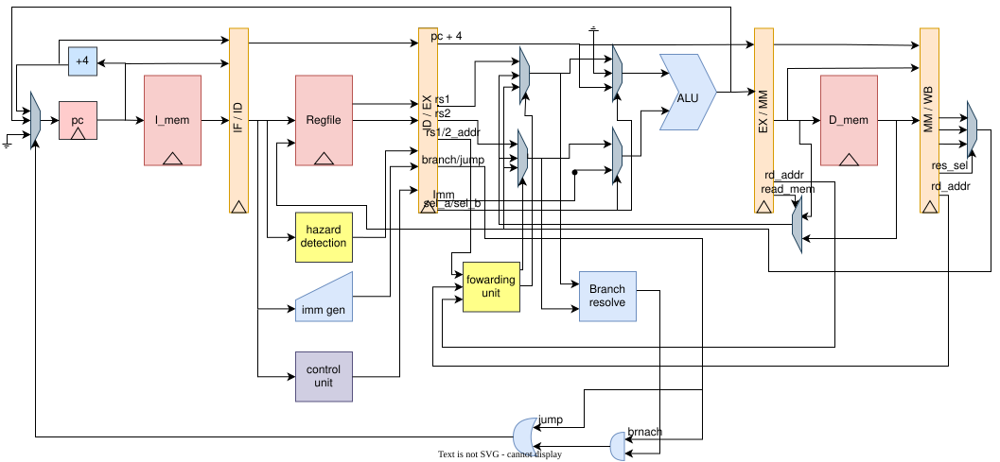

# 5-Stage Pipelined RV32I Processor in SystemVerilog

A 5-stage in-order RISC-V (RV32I) CPU written in SystemVerilog, with full data-hazard handling (forwarding + load-use stall) and control-hazard flushing. Verified in ModelSim with self-checking testbenches and implemented on an **Altera DE1 (Cyclone II EP2C20F484C7)**.

The repo contains two implementations of the same ISA subset:

| Version | Description |
|---|---|
| **Single-cycle** | Reference design. Validated first, then used to derive the pipeline. |
| **5-stage pipeline** | IF / ID / EX / MEM / WB with forwarding, load-use stall and branch/jump flush. |

---

## Results at a glance

| | |
|---|---|
| ISA | RV32I integer instructions, except byte and halfword loads/stores (see Next steps) |
| Pipeline | 5 stages, in-order, single-issue |
| Data hazards | Forwarding (EX/MEM and MEM/WB → EX), 1-cycle load-use stall |
| Control hazards | Branches and jumps resolved in EX, 2-instruction flush |
| Pipeline testbench | **57 / 57 checks pass** (ModelSim) |
| Target | Altera DE1, Cyclone II EP2C20F484C7, Quartus II 13.0.1 |
| Logic usage | **2,671 / 18,752 LEs (14 %)**, 816 registers |
| Memory | 10,240 bits (4 % of 239,616) in embedded RAM |
| Timing | **Fmax 63.07 MHz** |

---

## Architecture



| Stage | Work done |
|---|---|
| **IF** | PC register, instruction memory, `pc + 4`, PC mux (sequential or redirect) |
| **ID** | Decode, control unit, immediate generator, register-file read, Hazard detection |
| **EX** | Forwarding, ALU, branch comparison, redirect target |
| **MEM** | Data memory read/write |
| **WB** | Write-back mux (ALU result / load data / `pc + 4`) into the register file |


### Design decisions worth knowing

- **Separate instruction and data memories** (Harvard style), so fetch and load/store never compete for a port.
- **Control signals are decoded once, in ID**, and carried down the pipeline registers, so no later stage decodes again.
- **One ALU for everything.** Operand muxes (`rs1` / `pc` / `0`, and `rs2` / `imm`) let it do arithmetic, load/store addresses, branch and jump targets, `lui` and `auipc`.
- **Hazard logic lives in its own modules** (`hazard_unit`, `forwarding_unit`), separate from the datapath.
- **Unified redirect.** The ALU computes every jump and branch target (`pc + imm`, or `rs1 + imm` for `jalr` with bit 0 cleared); `branch_resolve` only decides whether a branch is taken.
- **Branches resolve in EX, with no prediction.** A taken branch or jump flushes two instructions; a not-taken branch costs nothing.
- **No spurious stalls.** `uses_rs1` / `uses_rs2` from the control unit stop immediate bits from being mistaken for register numbers.
- **x0** is never forwarded and never causes a stall.

### Hazard handling

| Hazard | Where detected | Resolution | Cost |
|---|---|---|---|
| RAW, producer in MEM | `forwarding_unit` | Forward EX/MEM value to EX | 0 cycles |
| RAW, producer in WB | `forwarding_unit` | Forward WB value to EX | 0 cycles |
| RAW, same cycle write/read | register file | Write-through on read | 0 cycles |
| Load-use | `hazard_unit` | Stall PC and IF/ID one cycle, insert a bubble into ID/EX, then forward | 1 cycle |
| Taken branch / `jal` / `jalr` | EX | Redirect PC, flush IF/ID and ID/EX | 2 cycles |
| WAR / WAW | not possible | In-order pipeline, writes happen in WB in program order | n/a |

---

## Verification

All verification is self-checking: every testbench prints `PASS` / `FAIL` per check and a final `ALL TESTS PASSED`.

**Unit testbenches:** `alu`, `regfile`, `imm_gen`, `control_unit`, `branch_resolve`, `hazard_unit`, `I_mem`, `D_mem`.

**Single-cycle integration:** a 13-instruction program, with a cycle-accurate `check_reg()` for every instruction.

**Pipeline integration (`tb_datapath_pipeline.sv`):** runs a 165-instruction program (see [Test program](asm/prog_pipeline.mem) and [`asm/test_program.md`](asm/test_program.md)). Every expected value was computed with a reference RV32I model that decodes the same machine code, and cross-checked against hand-written expectations. The program stores its own results to data memory with `sw`, so a wrong value anywhere shows up as one named failure.

| Group | Coverage |
|---|---|
| A | ALU→ALU forwarding from MEM and WB, both operands, dependent chains, MEM-over-WB priority |
| B | x0 never forwarded, never written |
| C | Load/store: store-data and store-base forwarding, load-use stall (rs1, rs2, store data, store base), load data forwarded from WB, `sw`→`lw` same address, spurious-stall regressions, `lw x0` |
| D | Load → branch (stall, then forward into the comparator) |
| E | All six branch types, taken and not taken, signed and unsigned, backward loop, poison instruction after every taken branch |
| F | `jal`, `jalr` (bit 0 cleared, forwarded `rs1`), call/return, chained jumps, link value read at the target |
| G | `lui`, `auipc`, every R-type and I-type ALU operation |

Three global checks make hazard behaviour measurable:
- **Exactly 5 load-use stall cycles**, so none are missing and none are spurious.
- **Exactly 14 redirects** (taken branches plus jumps).
- A **poison register (x31) and poison store (`mem[127]`)** placed on wrong paths must never be written, which proves every flush worked.

### Run it

In the ModelSim terminal, from `sim/`:

```tcl
vlib work
vlog -sv ../rtl/riscv_opcodes_pkg.sv
vlog -sv ../rtl/*.sv ../tb/tb_datapath_pipeline.sv
vsim -c work.tb_datapath_pipeline -do "run -all"
```

---

## FPGA implementation (Altera DE1)

| | |
|---|---|
| Tool | Quartus II 13.0.1 Build 232 SP1, Web Edition |
| Device | Cyclone II EP2C20F484C7 (last Quartus version that supports Cyclone II) |
| Top level | `DE1_top` |
| Compile time | about 1 min 12 s (synthesis 16 s, fitter 50 s) |

### Resource utilisation (after fit)

| Resource | Used | Available | % |
|---|---|---|---|
| Logic elements | 2,671 | 18,752 | 14 % |
| Combinational functions | 2,526 | 18,752 | 13 % |
| Dedicated logic registers | 816 | 18,752 | 4 % |
| Memory bits | 10,240 | 239,616 | 4 % |
| Pins | 53 | 315 | 17 % |

The register file and data memory are inferred as embedded RAM (`altsyncram`).

### Timing (TimeQuest, 50 MHz constraint on `CLOCK_50`)

| Check | Slow 85 °C model | Fast 0 °C model |
|---|---|---|
| Setup slack | **+4.144 ns** | +13.085 ns |
| Hold slack | +0.445 ns | +0.215 ns |
| Recovery slack | +17.214 ns | +18.285 ns |
| Removal slack | +2.538 ns | +1.595 ns |
| Min. pulse width slack | +7.436 ns | +7.873 ns |
| **Fmax** | **63.07 MHz** | n/a |

All checks pass with positive slack and zero total negative slack.

**Critical path.** The worst setup path (15.776 ns data delay) is : memory read → forwarding mux → branch comparison → PC mux.

---

## Repository layout

```
rtl/        SystemVerilog sources (ALU, register file, control, hazard/forwarding, datapaths)
tb/         Testbenches (unit tests + integration tests)
asm/        Test program (.mem) and its explanation (test_program.md)
FPGA/       Quartus project, DE1 top level, pin assignments, timing constraints
```

---

## Known limitations

- Only word loads and stores (`lw`, `sw`); byte and halfword accesses would need `funct3` carried to the MEM stage.
- No traps, CSRs, `fence`, `ecall` or `ebreak`.
- No branch predictor, caches or interrupts.

## Next steps

1. **Byte and halfword loads/stores** (`lb`, `lbu`, `lh`, `lhu`, `sb`, `sh`). Only `lw` / `sw` are implemented today; this completes the RV32I base integer ISA.
2. **`riscv-arch-test`**: run the official RV32I architectural compliance suite.

## Tools

SystemVerilog · ModelSim · Quartus II 13.0.1 · Git